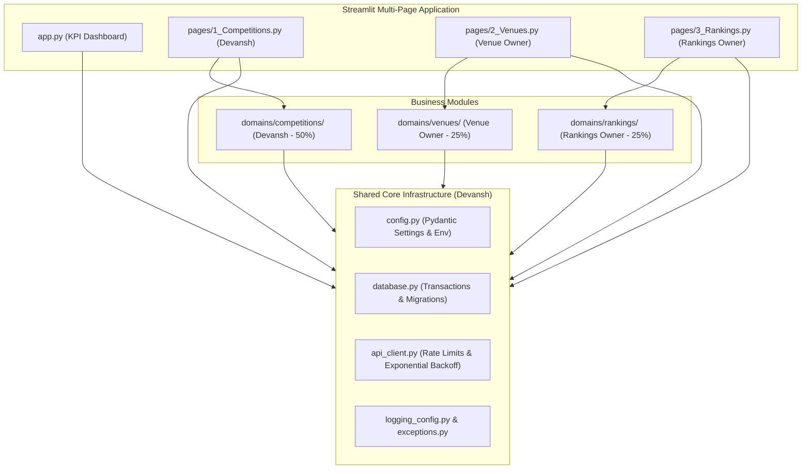
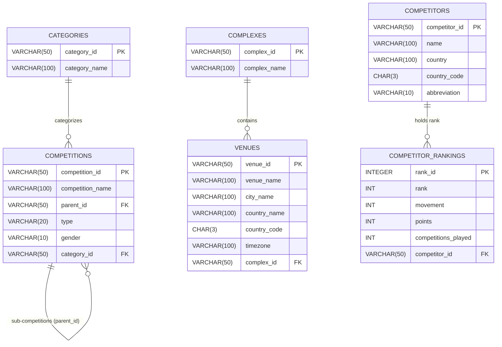

# 🎾 CourtIQ — Tennis Data & Analytics Explorer

[](https://www.python.org/)
[](docs/DATABASE_DESIGN.md)
[](https://streamlit.io/)
[](docs/ARCHITECTURE.md)
[]()

> **Explore Competitions. Analyse Rankings. Discover Tennis.**

CourtIQ is a professional, Sportradar-powered sports data exploration and analytics platform. Built using enterprise software engineering principles, the system transforms nested sports API responses into structured relational data, persists them in an ACID-compliant SQL database, executes analytical queries, and delivers actionable sports intelligence through an interactive Streamlit application.

---

## 🏆 Project Architecture & Contribution Model

CourtIQ is engineered as a three-contributor group product following a strict **50% / 25% / 25%** workload distribution:

| Contributor | Domain Ownership | Contribution | Status |
|---|---|:---:|:---:|
| **Devansh** | Project Architecture, Core Infrastructure & Competitions | **50%** | **COMPLETED & TESTED** |
| **Venue & Complexes Module Owner** | Complexes, Venues & Related Analytics | **25%** | Ready for Handoff |
| **Rankings & Analytics Module Owner** | Doubles Competitor Rankings & System Integration | **25%** | Scheduled for Handoff |



---

## 🚀 Quick Start & Installation

### 1. Clone the Repository
```bash
git clone https://github.com/Devansh54/CourtIQ.git
cd CourtIQ
```

### 2. Set Up Virtual Environment & Dependencies
```bash
python -m venv .venv
# On Windows:
.venv\Scripts\activate
# On macOS/Linux:
source .venv/bin/activate

pip install -r requirements.txt
```

### 3. Environment Configuration
Copy the template configuration file:
```bash
cp .env.example .env
```
*Note: If `SPORTRADAR_API_KEY` is not provided, CourtIQ operates automatically in verified Offline/Mock mode using realistic fixtures located in `tests/fixtures/`, requiring zero paid API keys or network access.*

### 4. Apply Migrations & Ingest Data
Run the standalone competitions ingestion script:
```bash
python scripts/ingest_competitions.py
```

### 5. Launch the Streamlit Dashboard
```bash
streamlit run app.py
```
Open your browser at `http://localhost:8501`.

### 6. Run the Test Suite
```bash
python -m pytest tests -v
```

---

## 📊 Database Architecture

The relational schema consists of six core tables across three business domains:



Detailed specifications and ERD: [`docs/DATABASE_DESIGN.md`](docs/DATABASE_DESIGN.md)

---

## ⚡ Competitions Domain & Verified SQL Queries

All 7 analytical SQL queries mandated by the project guide have been codified and verified:

| Query ID | Project Specification | SQL File |
|---|---|---|
| **Q1** | List all competitions along with their category name | [`sql/queries/competitions/q1_list_with_category.sql`](sql/queries/competitions/q1_list_with_category.sql) |
| **Q2** | Count the number of competitions in each category | [`sql/queries/competitions/q2_count_by_category.sql`](sql/queries/competitions/q2_count_by_category.sql) |
| **Q3** | Find all competitions of type 'doubles' | [`sql/queries/competitions/q3_doubles_competitions.sql`](sql/queries/competitions/q3_doubles_competitions.sql) |
| **Q4** | Get competitions that belong to a specific category (e.g. ITF Men) | [`sql/queries/competitions/q4_by_specific_category.sql`](sql/queries/competitions/q4_by_specific_category.sql) |
| **Q5** | Identify parent competitions and their sub-competitions | [`sql/queries/competitions/q5_parent_sub_hierarchy.sql`](sql/queries/competitions/q5_parent_sub_hierarchy.sql) |
| **Q6** | Analyze the distribution of competition types by category | [`sql/queries/competitions/q6_type_distribution_by_category.sql`](sql/queries/competitions/q6_type_distribution_by_category.sql) |
| **Q7** | List all competitions with no parent (top-level competitions) | [`sql/queries/competitions/q7_top_level_competitions.sql`](sql/queries/competitions/q7_top_level_competitions.sql) |

---

## 📚 Master Documentation Repository

All architectural decisions, schemas, and guidelines are maintained inside the repository:

- [`docs/PROJECT_OVERVIEW.md`](docs/PROJECT_OVERVIEW.md): Executive summary, business context, and use cases.
- [`docs/REQUIREMENTS.md`](docs/REQUIREMENTS.md): Comprehensive Requirements Traceability Matrix (56 requirements).
- [`docs/ARCHITECTURE.md`](docs/ARCHITECTURE.md): System architecture, layered design, and sequence diagrams.
- [`docs/TEAM_WORK_ALLOCATION.md`](docs/TEAM_WORK_ALLOCATION.md): 50/25/25 engineering workload breakdown and governance.
- [`docs/DATABASE_DESIGN.md`](docs/DATABASE_DESIGN.md): Relational database architecture, ERD, and migration rules.
- [`docs/API_DOCUMENTATION.md`](docs/API_DOCUMENTATION.md): Sportradar Tennis API v3 endpoints, rate limits, and schemas.
- [`docs/DATA_DICTIONARY.md`](docs/DATA_DICTIONARY.md): Column-level schema definitions across all 6 tables.
- [`docs/DEVELOPMENT_GUIDELINES.md`](docs/DEVELOPMENT_GUIDELINES.md): PEP 8 standards, parameterized SQL rules, and Git workflow.
- [`docs/IMPLEMENTATION_PLAN.md`](docs/IMPLEMENTATION_PLAN.md): 7-day agile sprint schedule and milestones.
- [`docs/IMPLEMENTATION_STATUS.md`](docs/IMPLEMENTATION_STATUS.md): Real-time task completion and milestone tracker.
- [`docs/reference/PROJECT_GUIDE.pdf`](docs/reference/PROJECT_GUIDE.pdf): Preserved original 14-page project specification.
- [`docs/handoffs/VENUES_MODULE_HANDOFF.md`](docs/handoffs/VENUES_MODULE_HANDOFF.md): Master developer handoff prompt for Venue & Complexes Owner.

---

## 🤝 Developer Handoff

For instructions on implementing Milestone 2, please consult:  
👉 [`docs/handoffs/VENUES_MODULE_HANDOFF.md`](docs/handoffs/VENUES_MODULE_HANDOFF.md)
