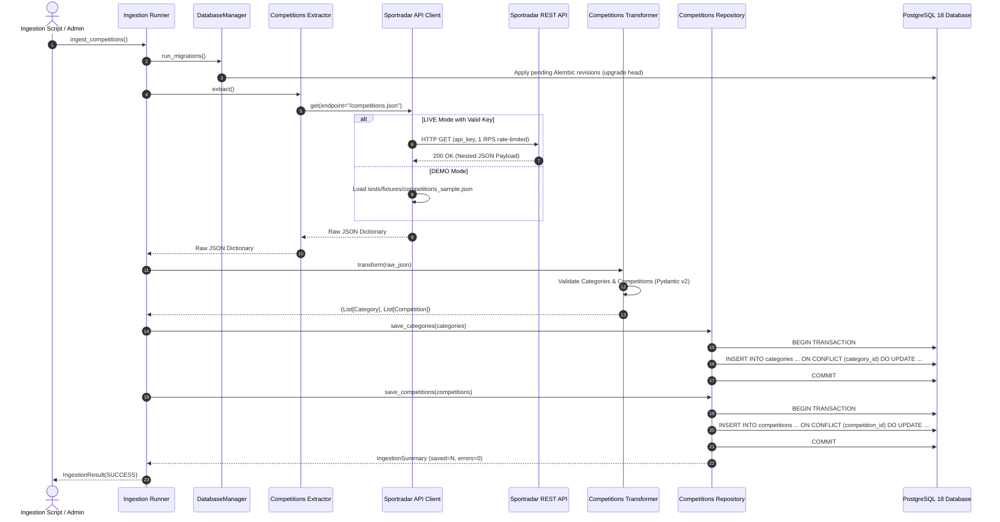
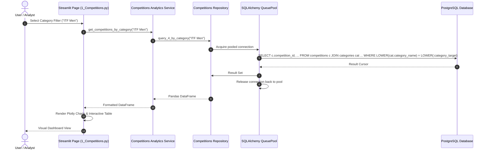

# CourtIQ — System Architecture & Engineering Design

**Product Name:** CourtIQ – Tennis Data & Analytics Explorer  
**Architecture Lead:** Devansh  
**Architecture Style:** Modular Domain-Driven Layered Architecture  
**Primary Database Engine:** PostgreSQL 18 (via SQLAlchemy 2.x Core & Psycopg 3)  
**Status:** Scalable PostgreSQL Foundation Active  

---

## 1. Architectural Principles & Goals

CourtIQ is designed to meet enterprise software engineering standards rather than functioning as a transient script. The architecture adheres to six core principles:

1. **Separation of Concerns:** Distinct separation between API networking, data transformation, database persistence, analytical aggregation, and UI presentation.
2. **Domain Encapsulation:** Clear boundaries between business domains (`competitions`, `venues`, `rankings`). Each domain encapsulates its own schemas, extractors, transformers, repositories, and analytics.
3. **Shared Infrastructure Reusability:** Core cross-cutting concerns (connection-pooled database connectivity, API clients, logging, configuration, error handling) are centralized in `src/courtiq/core/` and consumed uniformly by all module owners.
4. **True Multi-User Concurrency & Connection Pooling:** Database access uses SQLAlchemy 2.x `QueuePool` over PostgreSQL 18 connections, eliminating single-writer locks and supporting concurrent Streamlit dashboard interactions.
5. **Least-Privilege Security & Role Separation:** DDL operations are isolated to a migration-specific role (`courtiq_migrator`), while runtime queries execute under a restricted DML role (`courtiq_app`).
6. **Structured Migration Versioning:** Database schema evolution is managed through **Alembic**, providing deterministic and repeatable migrations across developer environments and CI/CD pipelines.

---

## 2. High-Level Layered Architecture

```mermaid
flowchart TD
    subgraph UI_Layer["1. Presentation Layer (Streamlit)"]
        APP["app.py (Homepage Dashboard & Global KPIs)"]
        PAGE1["pages/1_Competitions.py (Devansh - 50%)"]
        PAGE2["pages/2_Venues.py (Mansi - 25%)"]
        PAGE3["pages/3_Rankings.py (Nilakshi - 25%)"]
        UI_UTILS["src/courtiq/utils/formatting.py (Design System)"]
    end

    subgraph Domain_Layer["2. Business & Analytics Layer"]
        COMP_SVC["domains/competitions/analytics.py"]
        VEN_SVC["domains/venues/analytics.py"]
        RNK_SVC["domains/rankings/analytics.py"]
    end

    subgraph Ingestion_Layer["3. Ingestion & Transformation Layer"]
        RUNNER["ingestion/runner.py (CLI & Orchestrator)"]
        COMP_ETL["domains/competitions/ (extractor, transformer)"]
        VEN_ETL["domains/venues/ (extractor, transformer)"]
        RNK_ETL["domains/rankings/ (extractor, transformer)"]
        SCHEMAS["Domain Pydantic Schemas (validation)"]
    end

    subgraph Core_Infra["4. Core Infrastructure Layer"]
        CONFIG["core/config.py (Pydantic Settings, Env & Pool Config)"]
        API_CLIENT["core/api_client.py (Sportradar HTTP Client)"]
        DB_MGR["core/database.py (SQLAlchemy 2.x Engine & QueuePool)"]
        LOGGING["core/logging_config.py (Structured Logging)"]
        EXCEPTIONS["core/exceptions.py (Custom Exception Hierarchy)"]
    end

    subgraph Persistence_Layer["5. Relational Persistence Layer (PostgreSQL 18)"]
        REPOS["Domain Repositories (Parameterized Named SQL)"]
        ALEMBIC["alembic/ (Version Revisions: 0001_initial_competitions)"]
        QUERIES["sql/queries/ (Domain-Specific Analytical SQL)"]
        PG_DB[(PostgreSQL 18 Database / courtiq)]
        SQLITE_FALLBACK[(SQLite / Offline Test Fallback)]
    end

    subgraph External_Layer["6. External Integration"]
        API["Sportradar Tennis API v3 (REST / JSON)"]
        FIXTURES["tests/fixtures/ (Synthetic Mock Payloads)"]
    end

    %% Interactions
    APP & PAGE1 & PAGE2 & PAGE3 --> UI_UTILS
    PAGE1 --> COMP_SVC
    PAGE2 --> VEN_SVC
    PAGE3 --> RNK_SVC

    COMP_SVC & VEN_SVC & RNK_SVC --> REPOS
    REPOS --> DB_MGR
    DB_MGR --> PG_DB
    DB_MGR -.-> SQLITE_FALLBACK

    RUNNER --> COMP_ETL & VEN_ETL & RNK_ETL
    COMP_ETL & VEN_ETL & RNK_ETL --> SCHEMAS
    COMP_ETL & VEN_ETL & RNK_ETL --> API_CLIENT
    API_CLIENT --> API
    API_CLIENT -.-> FIXTURES

    COMP_ETL --> REPOS
    VEN_ETL --> REPOS
    RNK_ETL --> REPOS
    
    DB_MGR --> ALEMBIC
```



---

## 3. End-to-End Data Ingestion Sequence

The data pipeline guarantees strict validation and transactional integrity. Nested API payloads are parsed into immutable Pydantic entities before insertion into the relational database via PostgreSQL idempotent upserts (`ON CONFLICT (...) DO UPDATE`).



---

## 4. UI Query & Presentation Sequence

During ordinary Streamlit dashboard usage, no external API calls are made. Queries execute directly against the PostgreSQL database through pooled connections.



---

## 5. Persistence & Connection Pool Architecture

### 5.1 SQLAlchemy 2.x Engine & Connection Pooling
The application instantiates a centralized `DatabaseManager` backed by a SQLAlchemy `Engine`:
- **Pool Class:** `QueuePool` (default for PostgreSQL).
- **Pool Size:** `DB_POOL_SIZE` (default: 5 concurrent connections).
- **Max Overflow:** `DB_MAX_OVERFLOW` (default: 10 burst connections).
- **Connection Timeout:** `DB_POOL_TIMEOUT` (default: 30 seconds).
- **Recycle Interval:** `DB_POOL_RECYCLE` (default: 1800 seconds / 30 mins to avoid stale TCP drops).
- **Health Verification:** `pool_pre_ping=True` actively tests connections with a lightweight `SELECT 1` ping before handing them to caller threads.

### 5.2 Transaction Management & Safe Contexts
```python
# Context-managed transactional execution
with db.transaction() as conn:
    conn.execute(statement, params)
    # Automatically committed upon clean exit; automatically rolled back on exception
```

### 5.3 Alembic Schema Evolution
All database DDL is versioned as migrations under `alembic/versions/`:
- `0001_initial_competitions.py`: Creates `categories` and `competitions` tables, constraints, foreign keys, and indexes.
- Future versions `0002_venues.py` (Mansi) and `0003_rankings.py` (Nilakshi) extend the schema modularly without data loss.

---

## 6. Directory Structure

```text
CourtIQ/
├── app.py                         # Streamlit application entry point & dashboard
├── pages/                         # Streamlit domain exploration pages
│   ├── 1_Competitions.py          # Competitions explorer (Devansh)
│   ├── 2_Venues.py                # Venues explorer (Mansi)
│   └── 3_Rankings.py              # Rankings explorer (Nilakshi)
├── compose.yaml                   # Docker Compose specification for PostgreSQL 18
├── alembic.ini                    # Alembic migration configuration
├── alembic/                       # Alembic version migration scripts
│   ├── env.py                     # Dynamic database URL resolution & migration runner
│   └── versions/                  # Revision scripts (0001_initial_competitions.py)
├── docker/
│   └── postgres/init/             # Container role initialization SQL (01_init_roles.sql)
├── src/
│   └── courtiq/
│       ├── core/                  # Configuration, database manager, pooling, API client
│       ├── domains/
│       │   ├── competitions/      # Competitions schemas, extractor, repo, analytics
│       │   ├── venues/            # Venues domain scaffolding (ready for Mansi)
│       │   └── rankings/          # Rankings domain scaffolding (ready for Nilakshi)
│       ├── ingestion/             # Pipeline orchestration runner
│       └── utils/                 # Visual styling, formatting, CSS
├── sql/
│   ├── migrations/                # Historical SQL migration reference
│   └── queries/competitions/      # Project guide mandated SQL queries (q1–q7)
├── scripts/
│   ├── ingest_competitions.py     # Competitions ingestion executable CLI
│   └── migrate_sqlite_to_postgres.py # Safe SQLite-to-PostgreSQL migration utility
├── tests/
│   ├── fixtures/                  # Offline sample API JSON payloads
│   ├── unit/                      # Database, config, schema, repository unit tests
│   ├── integration/               # End-to-end pipeline integration tests
│   └── concurrency/               # Multi-threaded connection pool load tests
└── docs/                          # Comprehensive technical and architectural documentation
```
