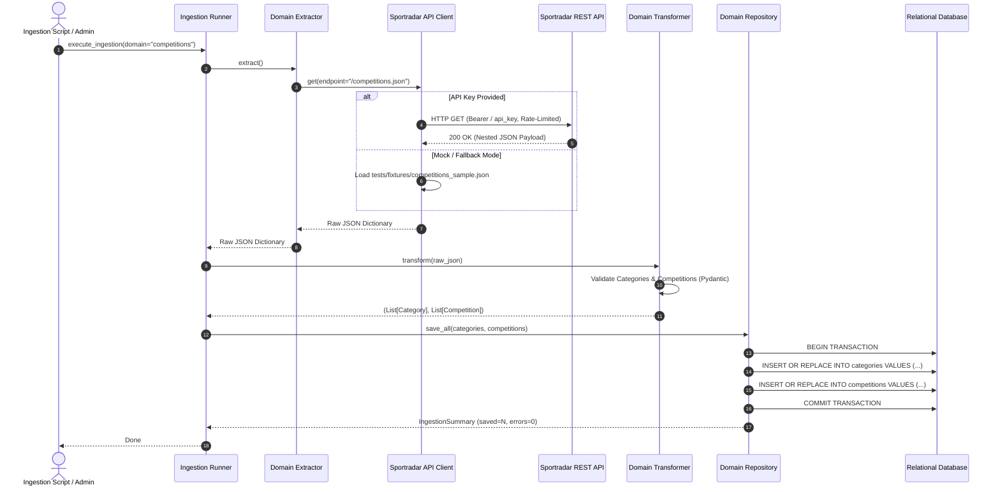
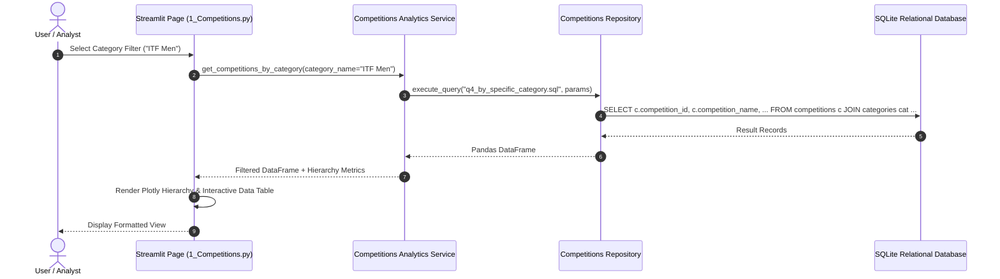

# CourtIQ — System Architecture & Engineering Design

**Product Name:** CourtIQ – Tennis Data & Analytics Explorer  
**Architecture Lead:** Devansh  
**Architecture Style:** Modular Domain-Driven Layered Architecture  
**Status:** Baseline Defined  

---

## 1. Architectural Principles & Goals

CourtIQ is designed to meet enterprise software engineering standards rather than functioning as a transient script. The architecture adheres to six core principles:

1. **Separation of Concerns:** Distinct separation between API networking, data transformation, database persistence, analytical aggregation, and UI presentation.
2. **Domain Encapsulation:** Clear boundaries between business domains (`competitions`, `venues`, `rankings`). Each domain encapsulates its own schemas, extractors, transformers, repositories, and analytics.
3. **Shared Infrastructure Reusability:** Core cross-cutting concerns (database connectivity, API clients, logging, configuration, error handling) are centralized in `src/courtiq/core/` and consumed uniformly by all module owners.
4. **Idempotent Ingestion:** Repetitive ingestion runs must update or merge records safely without primary/foreign-key violations or duplicated entries.
5. **Fail-Safe Offline Mode:** In the absence of live Sportradar API keys, the system transparently utilizes verified synthetic mock fixtures, ensuring full testability and offline demonstration capability.
6. **Zero-Friction Group Handoff:** Clean directory structures and explicit interface contracts enable sequential development across independent contributor environments.

---

## 2. High-Level Layered Architecture

```mermaid
flowchart TD
    subgraph UI_Layer["1. Presentation Layer (Streamlit)"]
        APP["app.py (Homepage Dashboard & Global KPIs)"]
        PAGE1["pages/1_Competitions.py (Devansh)"]
        PAGE2["pages/2_Venues.py (Venue Owner)"]
        PAGE3["pages/3_Rankings.py (Rankings Owner)"]
        UI_UTILS["src/courtiq/utils/formatting.py (Design System)"]
    end

    subgraph Domain_Layer["2. Business & Analytics Layer"]
        COMP_SVC["domains/competitions/analytics.py"]
        VEN_SVC["domains/venues/analytics.py"]
        RNK_SVC["domains/rankings/analytics.py"]
    end

    subgraph Ingestion_Layer["3. Ingestion & Transformation Layer"]
        RUNNER["ingestion/runner.py (CLI & Orchestrator)"]
        COMP_ETL["domains/competitions/ (extractor, transformer)"]
        VEN_ETL["domains/venues/ (extractor, transformer)"]
        RNK_ETL["domains/rankings/ (extractor, transformer)"]
        SCHEMAS["Domain Pydantic Schemas (validation)"]
    end

    subgraph Core_Infra["4. Core Infrastructure Layer"]
        CONFIG["core/config.py (Environment & Settings)"]
        API_CLIENT["core/api_client.py (Sportradar HTTP Client)"]
        DB_MGR["core/database.py (Connection & Transactions)"]
        LOGGING["core/logging_config.py (Structured Logs)"]
        EXCEPTIONS["core/exceptions.py (Custom Exception Hierarchy)"]
    end

    subgraph Persistence_Layer["5. Relational Persistence Layer (SQL)"]
        REPOS["Domain Repositories (Parameterized SQL)"]
        MIGRATIONS["sql/migrations/ (001, 002, 003)"]
        QUERIES["sql/queries/ (20 Analytical SQL Files)"]
        DB[(courtiq.db / SQLite Relational Storage)]
    end

    subgraph External_Layer["6. External Integration"]
        API["Sportradar Tennis API v3 (REST / JSON)"]
        FIXTURES["tests/fixtures/ (Synthetic Mock Payloads)"]
    end

    %% Interactions
    APP & PAGE1 & PAGE2 & PAGE3 --> UI_UTILS
    PAGE1 --> COMP_SVC
    PAGE2 --> VEN_SVC
    PAGE3 --> RNK_SVC

    COMP_SVC & VEN_SVC & RNK_SVC --> REPOS
    REPOS --> DB_MGR
    DB_MGR --> DB

    RUNNER --> COMP_ETL & VEN_ETL & RNK_ETL
    COMP_ETL & VEN_ETL & RNK_ETL --> SCHEMAS
    COMP_ETL & VEN_ETL & RNK_ETL --> API_CLIENT
    API_CLIENT --> API
    API_CLIENT -.-> FIXTURES

    COMP_ETL --> REPOS
    VEN_ETL --> REPOS
    RNK_ETL --> REPOS
    
    DB_MGR --> MIGRATIONS
```



---

## 3. End-to-End Data Ingestion Sequence

The data pipeline guarantees strict validation and transactional integrity. Nested API payloads are parsed into immutable Pydantic entities before insertion into the relational database.



---

## 4. UI Query & Presentation Sequence

During ordinary Streamlit dashboard usage, no live API calls are made. Queries execute directly against the optimized relational database with Streamlit caching.



---

## 5. Directory Architecture & Boundary Contracts

The codebase strictly preserves the following directory structure:

```text
CourtIQ/
│
├── app.py                          # Streamlit Entrypoint & Global KPI Dashboard
├── requirements.txt                # Production Dependencies
├── pyproject.toml                  # Python Packaging & Pytest Settings
├── README.md                       # Master Documentation
├── .env.example                    # Environment Template
├── .gitignore                      # Security and Artifact Exclusions
│
├── src/
│   └── courtiq/
│       ├── __init__.py
│       │
│       ├── core/                   # SHARED FOUNDATION (Devansh)
│       │   ├── __init__.py
│       │   ├── config.py           # Pydantic Settings & Env Loader
│       │   ├── database.py         # DB Manager, Migration Engine & Transactions
│       │   ├── api_client.py       # Sportradar HTTP Client with Rate-Limit & Retries
│       │   ├── exceptions.py       # Domain Exception Hierarchy
│       │   └── logging_config.py   # Structured Logging
│       │
│       ├── domains/                # DOMAIN MODULES
│       │   ├── __init__.py
│       │   ├── competitions/       # COMPETITIONS DOMAIN (Devansh - 50%)
│       │   │   ├── __init__.py
│       │   │   ├── schemas.py      # Pydantic Models (Category, Competition)
│       │   │   ├── extractor.py    # API Extractor
│       │   │   ├── transformer.py  # JSON Normalizer
│       │   │   ├── repository.py   # SQL Persistence & 7 Queries
│       │   │   └── analytics.py    # Analytics Service
│       │   │
│       │   ├── venues/             # VENUES DOMAIN (Venue Owner - 25%)
│       │   │   ├── schemas.py
│       │   │   ├── extractor.py
│       │   │   ├── transformer.py
│       │   │   ├── repository.py
│       │   │   └── analytics.py
│       │   │
│       │   └── rankings/           # RANKINGS DOMAIN (Rankings Owner - 25%)
│       │       ├── schemas.py
│       │       ├── extractor.py
│       │       ├── transformer.py
│       │       ├── repository.py
│       │       └── analytics.py
│       │
│       ├── ingestion/              # PIPELINE ORCHESTRATION
│       │   ├── __init__.py
│       │   └── runner.py           # CLI Pipeline Runner
│       │
│       └── utils/                  # SHARED UTILITIES
│           ├── __init__.py
│           └── formatting.py       # Streamlit CSS, Metrics, and Badges
│
├── pages/                          # STREAMLIT MULTI-PAGE APPLICATION
│   ├── 1_Competitions.py           # Competitions Explorer (Devansh)
│   ├── 2_Venues.py                 # Venues Explorer (Venue Owner)
│   └── 3_Rankings.py               # Rankings Explorer (Rankings Owner)
│
├── sql/                            # RAW SQL FILES
│   ├── migrations/                 # DDL Schemas (001, 002, 003)
│   └── queries/                    # All 20 Documented Queries
│       ├── competitions/           # 7 Queries (Devansh)
│       ├── venues/                 # 7 Queries (Venue Owner)
│       └── rankings/               # 6 Queries (Rankings Owner)
│
├── scripts/                        # RUNNABLE SCRIPTS
│   └── ingest_competitions.py      # Competitions Ingestion Executable
│
├── tests/                          # TEST SUITE
│   ├── conftest.py
│   ├── fixtures/                   # Realistic Mock Payloads
│   ├── unit/                       # Unit Tests (Core & Competitions)
│   └── integration/                # End-to-end Integration Tests
│
└── docs/                           # COMPREHENSIVE DOCUMENTATION
    ├── reference/PROJECT_GUIDE.pdf # Preserved Original Source Guide
    ├── handoffs/                   # Contributor Handoff Prompts
    ├── REQUIREMENTS.md             # RTM Matrix
    ├── ARCHITECTURE.md             # Architectural Design
    ├── DATABASE_DESIGN.md          # ERD & Schema Specs
    ├── API_DOCUMENTATION.md        # API Specifications & Mapping
    ├── DATA_DICTIONARY.md          # Column-Level Definitions
    ├── TEAM_WORK_ALLOCATION.md     # 50-25-25 Distribution
    ├── DEVELOPMENT_GUIDELINES.md   # Coding Standards & Git Rules
    └── IMPLEMENTATION_STATUS.md    # Real-Time Project Tracking
```

---

## 6. Shared Component Specifications

### 6.1 Centralized Configuration (`core/config.py`)
Encapsulates all settings via `pydantic-settings` or dataclasses:
- `SPORTRADAR_API_KEY`: API key for trial access.
- `SPORTRADAR_BASE_URL`: Defaults to `https://api.sportradar.com/tennis/trial/v3/en`.
- `COURTIQ_DB_PATH`: Defaults to `data/courtiq.db`.
- `LOG_LEVEL`: Configurable logging level.

### 6.2 Sportradar API Client (`core/api_client.py`)
- Rate limiting: strictly adheres to Sportradar's trial rate limit of 1 request per second using token-bucket or time-interval sleep.
- Retries: built with exponential backoff on HTTP 429 and 5xx errors.
- Mock fallback: if API key is invalid or unavailable, seamlessly serves verified fixtures from `tests/fixtures/`.

### 6.3 Database Engine (`core/database.py`)
- Context manager for connection and transaction lifecycle (`with db.transaction() as cur:`).
- Automatic execution of DDL migrations upon boot.
- Parameterized execution to defend against SQL injection.
