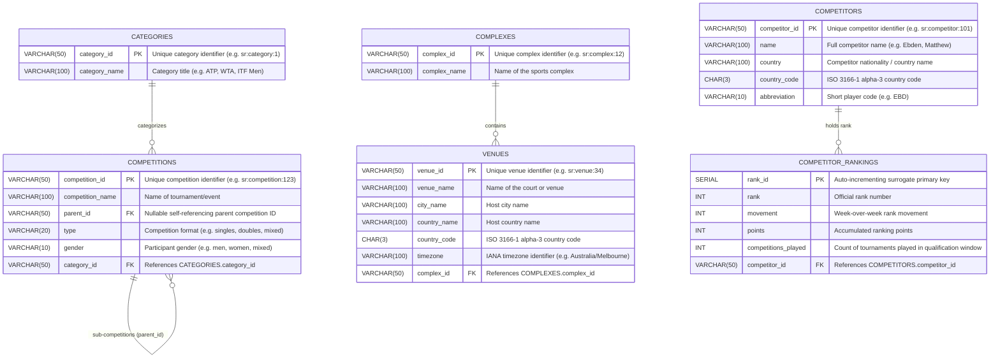

# CourtIQ — Relational Database Architecture & Design

**Product Name:** CourtIQ – Tennis Data & Analytics Explorer  
**Document Status:** Approved PostgreSQL-First Architecture  
**Lead Architect:** Devansh  
**Target Engine:** PostgreSQL 18 (Production & Evaluation) / SQLite (Isolated Testing Fallback)  
**Database Driver:** Psycopg 3 (`psycopg[binary]>=3.1.18`)  
**ORM / Engine:** SQLAlchemy 2.x Core with `QueuePool`  
**Migration Tool:** Alembic  

---

## 1. Database Architecture Overview

CourtIQ relies on a normalized relational schema composed of six core tables distributed across three functional business domains. The database enforces referential integrity through foreign keys, prevents invalid states with `NOT NULL` constraints, optimizes analytical query performance using targeted indexes, and supports idempotent upsert operations (`ON CONFLICT (...) DO UPDATE`).



---

## 2. Table Specifications & Column Definitions

### 2.1 Domain: Competitions & Categories (Owner: Devansh — 50%)

#### Table: `categories`
Stores organizing bodies and tournament categories (e.g., ATP, WTA, ITF Men, ITF Women).

| Column Name | PostgreSQL Data Type | Constraints | Description |
|---|---|---|---|
| `category_id` | `VARCHAR(50)` | `PRIMARY KEY` | Unique ID from Sportradar (e.g., `sr:category:1`). |
| `category_name` | `VARCHAR(100)` | `NOT NULL` | Display name of the category. |

#### Table: `competitions`
Stores individual competitions, tournaments, and events, supporting multi-level hierarchies.

| Column Name | PostgreSQL Data Type | Constraints | Description |
|---|---|---|---|
| `competition_id` | `VARCHAR(50)` | `PRIMARY KEY` | Unique ID from Sportradar (e.g., `sr:competition:101`). |
| `competition_name` | `VARCHAR(100)` | `NOT NULL` | Full tournament name. |
| `parent_id` | `VARCHAR(50)` | `NULLABLE`, `REFERENCES competitions(competition_id) ON DELETE SET NULL` | Self-referencing parent ID for qualifying/sub-tournaments. |
| `type` | `VARCHAR(20)` | `NOT NULL` | Competition type (e.g., `singles`, `doubles`, `mixed`). |
| `gender` | `VARCHAR(10)` | `NOT NULL` | Participant gender (`men`, `women`, `mixed`). |
| `category_id` | `VARCHAR(50)` | `NOT NULL`, `FOREIGN KEY REFERENCES categories(category_id) ON DELETE RESTRICT` | Links to category entity. |

**PostgreSQL Indexes:**
- `idx_competitions_category_id` ON `competitions(category_id)`
- `idx_competitions_parent_id` ON `competitions(parent_id)`
- `idx_competitions_type_gender` ON `competitions(type, gender)`

---

### 2.2 Domain: Complexes & Venues (Owner: Mansi — 25%)

#### Table: `complexes`
Stores tennis complexes and tournament grounds.

| Column Name | PostgreSQL Data Type | Constraints | Description |
|---|---|---|---|
| `complex_id` | `VARCHAR(50)` | `PRIMARY KEY` | Unique ID from Sportradar (e.g., `sr:complex:12`). |
| `complex_name` | `VARCHAR(100)` | `NOT NULL` | Name of the tennis complex. |

#### Table: `venues`
Stores specific venues, stadia, or courts housed within a complex.

| Column Name | PostgreSQL Data Type | Constraints | Description |
|---|---|---|---|
| `venue_id` | `VARCHAR(50)` | `PRIMARY KEY` | Unique ID from Sportradar (e.g., `sr:venue:45`). |
| `venue_name` | `VARCHAR(100)` | `NOT NULL` | Name of the venue or stadium. |
| `city_name` | `VARCHAR(100)` | `NOT NULL` | Host city name. |
| `country_name` | `VARCHAR(100)` | `NOT NULL` | Host country name. |
| `country_code` | `CHAR(3)` | `NOT NULL` | ISO 3-character country code (e.g., `USA`, `GBR`, `CHL`). |
| `timezone` | `VARCHAR(100)` | `NOT NULL` | IANA timezone string (e.g., `America/Santiago`). |
| `complex_id` | `VARCHAR(50)` | `NOT NULL`, `FOREIGN KEY REFERENCES complexes(complex_id) ON DELETE CASCADE` | Parent sports complex ID. |

**PostgreSQL Indexes:**
- `idx_venues_complex_id` ON `venues(complex_id)`
- `idx_venues_country_code` ON `venues(country_code)`
- `idx_venues_city_name` ON `venues(city_name)`

---

### 2.3 Domain: Doubles Competitor Rankings (Owner: Nilakshi — 25%)

#### Table: `competitors`
Stores player profiles and national federations.

| Column Name | PostgreSQL Data Type | Constraints | Description |
|---|---|---|---|
| `competitor_id` | `VARCHAR(50)` | `PRIMARY KEY` | Unique ID from Sportradar (e.g., `sr:competitor:101`). |
| `name` | `VARCHAR(100)` | `NOT NULL` | Player full name (e.g., `Granollers, Marcel`). |
| `country` | `VARCHAR(100)` | `NOT NULL` | Player nationality. |
| `country_code` | `CHAR(3)` | `NOT NULL` | ISO 3-character country code (e.g., `ESP`). |
| `abbreviation` | `VARCHAR(10)` | `NOT NULL` | Player scoreboard abbreviation (e.g., `GRA`). |

#### Table: `competitor_rankings`
Stores doubles ranking standings, point totals, and weekly rank movements.

| Column Name | PostgreSQL Data Type | Constraints | Description |
|---|---|---|---|
| `rank_id` | `SERIAL` | `PRIMARY KEY` | Unique surrogate key for ranking row. |
| `rank` | `INT` | `NOT NULL` | Official world doubles ranking position. |
| `movement` | `INT` | `NOT NULL` | Rank change relative to previous weekly update. |
| `points` | `INT` | `NOT NULL` | Total ranking points. |
| `competitions_played` | `INT` | `NOT NULL` | Number of events played during qualifying period. |
| `competitor_id` | `VARCHAR(50)` | `NOT NULL`, `FOREIGN KEY REFERENCES competitors(competitor_id) ON DELETE CASCADE` | Foreign key to competitor. |

**PostgreSQL Indexes:**
- `idx_rankings_competitor_id` ON `competitor_rankings(competitor_id)`
- `idx_rankings_rank` ON `competitor_rankings(rank)`
- `idx_rankings_points` ON `competitor_rankings(points DESC)`

---

## 3. Database Security & Least-Privilege Roles

PostgreSQL enforces database security by splitting responsibilities into two distinct roles:

1. **`courtiq_migrator` (DDL Administrator):**
   - Owns schema tables, executes Alembic migrations, creates indexes, alters columns.
   - Connected via `MIGRATION_DATABASE_URL`.
2. **`courtiq_app` (Runtime Client):**
   - Granted `SELECT`, `INSERT`, `UPDATE`, `DELETE` on all tables; `USAGE`, `SELECT` on sequences.
   - Strictly prohibited from `DROP TABLE`, `ALTER TABLE`, or creating new objects.
   - Connected via `DATABASE_URL`.

---

## 4. Connection Pooling Architecture

PostgreSQL concurrency is managed through SQLAlchemy 2.x `QueuePool`:
- **Pool Size:** `5` persistent connections (`DB_POOL_SIZE`).
- **Max Overflow:** `10` transient connections during burst traffic (`DB_MAX_OVERFLOW`).
- **Pool Timeout:** `30` seconds waiting for available connection (`DB_POOL_TIMEOUT`).
- **Recycle:** `1800` seconds (30 mins) to prevent stale connections from being terminated by firewalls (`DB_POOL_RECYCLE`).
- **Pre-Ping:** `pool_pre_ping=True` transparently probes connections with `SELECT 1` to recover from connection drops.

---

## 5. Migration Execution with Alembic

All schema evolution is version-controlled in `alembic/versions/`:
```text
alembic/versions/
├── 0001_initial_competitions.py   # Categories & Competitions (Devansh)
├── 0002_venues.py                 # Complexes & Venues (Mansi)
└── 0003_rankings.py               # Competitors & Rankings (Nilakshi)
```

### Applying Migrations
```bash
alembic upgrade head
```

Alembic records migration versions in the `alembic_version` system table (`version_num VARCHAR(32)`).
