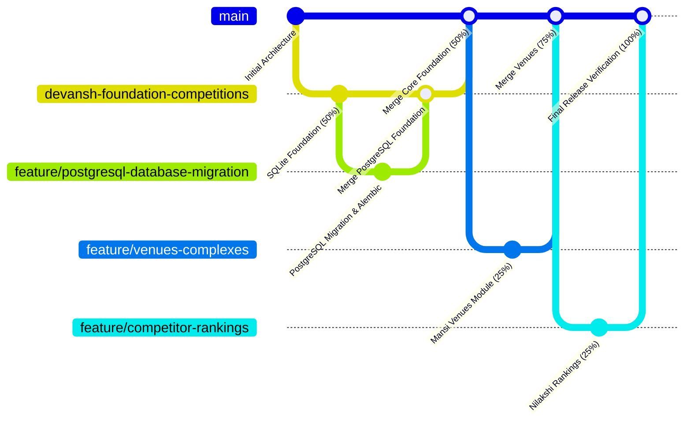

# CourtIQ — Development Guidelines & Engineering Conventions

**Product Name:** CourtIQ – Tennis Data & Analytics Explorer  
**Version:** 2.0.0 (PostgreSQL Foundation)  
**Lead Architect:** Devansh  
**Target Database:** PostgreSQL 16+ via SQLAlchemy 2.x & Psycopg 3  

---

## 1. Coding & Python Standards

All code contributed to the CourtIQ platform must adhere strictly to professional Python engineering standards:

1. **PEP 8 Compliance:** 4-space indentation, descriptive variable naming, standard line lengths.
2. **Type Annotations:** Function definitions must include type hints for all parameters and return types (e.g., `def get_competition(comp_id: str) -> Optional[Competition]:`).
3. **Docstrings & Comments:** Every module, class, and public function must have docstrings explaining purpose, parameters, return values, and exceptions. Preserve existing comments and docstrings.
4. **Defensive Error Handling:** Catch domain-specific exceptions (`DatabaseError`, `APIClientError`, `ValidationError`). Never catch generic exceptions silently (`except: pass`).
5. **Security & Credentials:**
   - NEVER commit `.env` or credentials to Git.
   - Always access runtime settings through `courtiq.core.config.get_settings()`.

---

## 2. PostgreSQL & Database Engineering Standards

CourtIQ uses **PostgreSQL 16+** with **SQLAlchemy 2.x Core** and **Psycopg 3**. Contributors (Mansi and Nilakshi) must follow these database conventions:

### 2.1 Strictly Named Parameterized Queries
Under no circumstances should string concatenation or raw f-strings be used to interpolate values into SQL. Always use SQLAlchemy named parameters (`:param_name`):

```python
# CORRECT (Safe Parameterized Binding):
stmt = "SELECT * FROM venues WHERE city_name = :city_target AND country_code = :country_target;"
params = {"city_target": "Melbourne", "country_target": "AUS"}
df = db.fetch_df(stmt, params=params)

# FORBIDDEN (Vulnerable to SQL Injection & dialect incompatibilities):
db.fetch_df(f"SELECT * FROM venues WHERE city_name = '{city}'")
```

### 2.2 Idempotent Upserts (`ON CONFLICT DO UPDATE`)
All batch inserts must be idempotent to allow pipelines to re-run without throwing unique constraint or primary key errors:

```sql
INSERT INTO complexes (complex_id, complex_name)
VALUES (:complex_id, :complex_name)
ON CONFLICT (complex_id) DO UPDATE SET
    complex_name = EXCLUDED.complex_name;
```

### 2.3 Context-Managed Transactions
All writes (INSERT, UPDATE, DELETE) must execute inside `db.transaction()` blocks to guarantee ACID atomicity:

```python
with db.transaction() as conn:
    conn.execute(statement, params)
    # Automatically committed upon normal block exit
    # Automatically rolled back if any exception is raised
```

### 2.4 Alembic Schema Migrations
Do NOT execute manual DDL or raw SQL scripts directly against the database. All new domain tables must be added through Alembic revisions in `alembic/versions/`:

1. **Creating a new revision:**
   ```bash
   alembic revision -m "add_venues_and_complexes"
   ```
2. **Implementing `upgrade()` and `downgrade()`:**
   Use standard `op.create_table()`, `op.add_column()`, and `op.create_index()` constructs.
3. **Applying the migration:**
   ```bash
   alembic upgrade head
   ```

### 2.5 Referential Dependency Order
PostgreSQL strictly enforces foreign keys. Always persist entities in referential order:
1. `categories` before `competitions` (and parent competitions before sub-competitions)
2. `complexes` before `venues`
3. `competitors` before `competitor_rankings`

---

## 3. Git Workflow & Branching Strategy



### Branching Rules
- **`main`**: Protected primary production branch. Contains stable, integrated milestones.
- **`devansh-foundation-competitions`**: Devansh's foundation branch (Overall Architecture, Core Infra, Competitions Domain).
- **`feature/venues-complexes`**: Mansi's development branch (Complexes, Venues & Related Analytics — 25%).
- **`feature/competitor-rankings`**: Nilakshi's development branch (Doubles Competitor Rankings & Final Verification — 25%).

---

## 4. Module Ownership Boundaries

| Functional Area | Contributor | Boundary & Modification Rules |
|---|---|---|
| `src/courtiq/core/` (DB, Pooling, Config, API Client) | Devansh | **IMMUTABLE for subsequent owners.** Shared infrastructure. |
| `src/courtiq/domains/competitions/` | Devansh | Domain-owned by Devansh. |
| `src/courtiq/domains/venues/` | Mansi | Domain-owned by Mansi. |
| `src/courtiq/domains/rankings/` | Nilakshi | Domain-owned by Nilakshi. |
| `alembic/versions/0001_initial_competitions.py` | Devansh | Baseline schema. Immutable. |
| `alembic/versions/0002_venues.py` | Mansi | Venues domain migration. |
| `alembic/versions/0003_rankings.py` | Nilakshi | Rankings domain migration. |
| `app.py` & `src/courtiq/utils/formatting.py` | Devansh | Core UI framework and layout. |
| `pages/1_Competitions.py` | Devansh | Competitions Explorer page. |
| `pages/2_Venues.py` | Mansi | Venues Explorer page. |
| `pages/3_Rankings.py` | Nilakshi | Rankings Explorer page. |

---

## 5. Local Testing & Verification Workflow

Before submitting a pull request or handing off work:
1. Ensure the PostgreSQL container is running:
   ```bash
   docker compose up -d
   ```
2. Run Alembic migrations:
   ```bash
   alembic upgrade head
   ```
3. Run the full pytest suite (including concurrency and unit tests):
   ```bash
   pytest tests -v
   ```
4. Verify Streamlit dashboard rendering:
   ```bash
   streamlit run app.py
   ```
