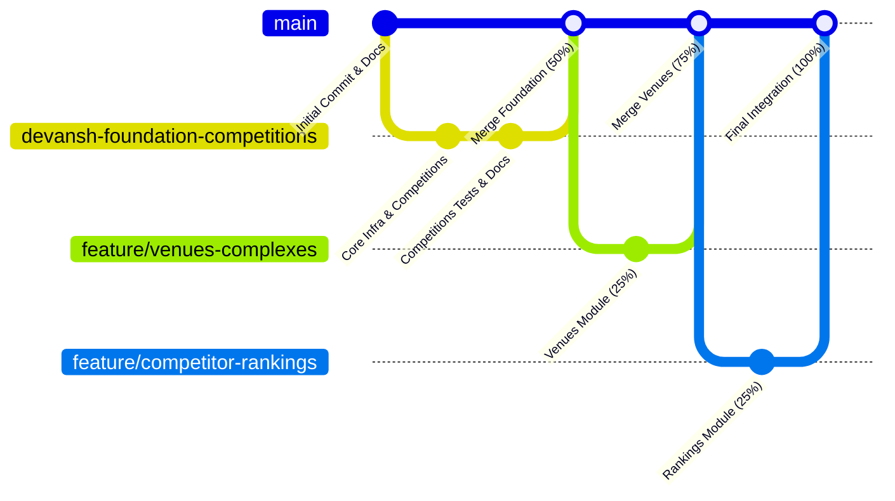

# CourtIQ — Development Guidelines & Engineering Conventions

**Product Name:** CourtIQ – Tennis Data & Analytics Explorer  
**Version:** 1.0.0  
**Lead Architect:** Devansh  

---

## 1. Coding & Python Standards

All code contributed to the CourtIQ platform must adhere strictly to Python best practices:

1. **PEP 8 Compliance:** All code must conform to PEP 8 styling conventions. Use 4-space indentation, clear variable naming, and standard line-length limits.
2. **Type Annotations:** Function definitions must include type hints for all parameters and return types (e.g., `def get_competition(comp_id: str) -> Optional[Competition]:`).
3. **Docstrings & Comments:** Every module, class, and public function must have Google-style or Sphinx-style docstrings explaining purpose, arguments, and return types. Preserve all existing docstrings and architectural notes.
4. **Error Handling:** Never catch generic exceptions silently (avoid `except: pass`). Catch domain-specific exceptions, log the failure with stack trace where appropriate, and re-raise or handle gracefully.
5. **Security & Credentials:**
   - NEVER commit `.env` or plain-text credentials to Git.
   - Use `courtiq.core.config.get_settings()` to load environment variables.

---

## 2. Database & SQL Engineering Standards

1. **Strictly Parameterized Queries:** Under no circumstances should string concatenation or raw f-strings be used to interpolate user input into SQL queries. Always use standard parameter binding (`?` for SQLite, `%s` for MySQL/Postgres).
   ```python
   # Correct:
   cursor.execute("SELECT * FROM competitions WHERE type = ?", (comp_type,))
   
   # FORBIDDEN (Vulnerable to SQL Injection):
   cursor.execute(f"SELECT * FROM competitions WHERE type = '{comp_type}'")
   ```
2. **ACID Transaction Management:** All writes (INSERT, UPDATE, DELETE) must execute inside explicit transactions using `db.transaction()`:
   ```python
   with db.transaction() as conn:
       conn.execute(...)
   ```
3. **Referential Integrity:** Foreign keys must always be respected. Parents must be inserted before children (`categories` before `competitions`, `complexes` before `venues`, `competitors` before `competitor_rankings`).
4. **Migration Standards:** All table creation and structural changes must be codified in `sql/migrations/` using three-digit prefixes (`001_competitions.sql`, `002_venues.sql`, `003_rankings.sql`).

---

## 3. Git Workflow & Branching Strategy



### 3.1 Branching Rules
- **`main`**: Protected primary production branch. Contains stable, integrated milestones.
- **`devansh-foundation-competitions`**: Devansh's working branch for Core Infrastructure and Competitions Domain (50%).
- **`feature/venues-complexes`**: Venue & Complexes Module Owner's development branch (25%).
- **`feature/competitor-rankings`**: Rankings & Analytics Module Owner's development branch (25%).

### 3.2 Commit Message Standards
Use clear imperative commit messages with domain tags:
- `feat(core): implement sportradar api client with rate limiting`
- `feat(competitions): add json transformer and pydantic models`
- `feat(competitions): implement 7 required sql queries and analytics service`
- `test(competitions): add unit and integration pipeline tests`
- `docs(handoff): prepare venues module developer handoff prompt`

---

## 4. Module Ownership Boundaries & Change Management

| Functional Area | Primary Owner | Modification Guidelines |
|---|---|---|
| `src/courtiq/core/` (API, DB, Config, Logging) | Devansh | **IMMUTABLE for subsequent owners.** Do not rewrite or replace. If an enhancement is required, document it in an issue. |
| `src/courtiq/domains/competitions/` | Devansh | Domain-owned by Devansh. Venues and Rankings owners must not edit. |
| `src/courtiq/domains/venues/` | Venue & Complexes Module Owner | Domain-owned. |
| `src/courtiq/domains/rankings/` | Rankings & Analytics Module Owner | Domain-owned. |
| `sql/migrations/001_competitions.sql` | Devansh | Immutable once merged. |
| `sql/migrations/002_venues.sql` | Venue & Complexes Module Owner | Domain-owned migration. |
| `sql/migrations/003_rankings.sql` | Rankings & Analytics Module Owner | Domain-owned migration. |
| `app.py` & `src/courtiq/utils/formatting.py` | Devansh | Base UI shell owned by Devansh. Module owners contribute page content to `pages/`. |

---

## 5. Streamlit UI Development Standards

1. **Shared Layout & Styling:** Always import and apply `apply_custom_css()` from `courtiq.utils.formatting`. Maintain consistent headers, cards, and KPI metrics.
2. **Database Query Caching:** Wrap database reads with `@st.cache_data(ttl=60)` or read through the repository layer to prevent redundant disk I/O on UI rerenders.
3. **Empty States & Error Handling:** When a table has zero rows (e.g., before ingestion has run), display an informative callout box directing the user to run the ingestion command, rather than throwing an unhandled exception or showing a blank page.
4. **Responsive Visualizations:** Use Plotly charts with responsive sizing (`use_container_width=True`) and clean tennis-themed color palettes (`#1E88E5`, `#26A69A`, `#FFA726`, `#D81B60`).
