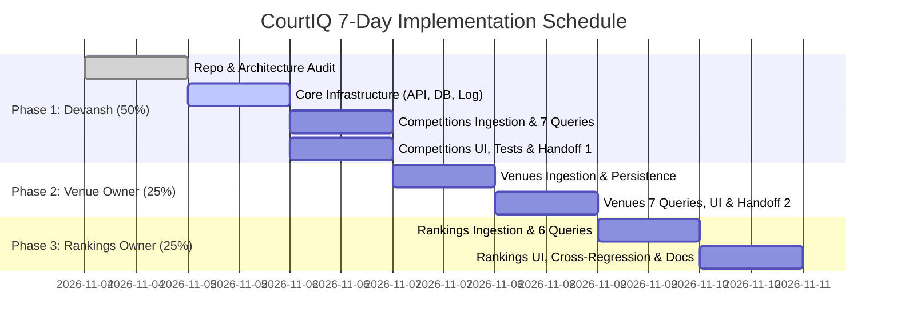

# CourtIQ — Master Implementation & Milestone Plan

**Product Name:** CourtIQ – Tennis Data & Analytics Explorer  
**Timeline:** 7-Day Agile Sequential Engineering Sprint  
**Version:** 1.0.0  
**Lead Architect:** Devansh  

---

## 1. Timeline & Milestone Schedule

The project follows a 7-day sequential sprint cycle, aligning with the evaluation timeline specified in the project guide.

---

## 2. Milestone Deliverables & Gate Verification

### Milestone 1: Foundation & Competitions (Devansh — 50%)
- **Target Completion:** Day 3
- **Gate Criteria:**
  - Git repository initialized and connected to remote.
  - Complete shared infrastructure in `courtiq.core` fully operational and tested.
  - SQLite database operational with `001_competitions.sql` migration applied.
  - Categories and Competitions ingestion pipeline functioning for both live API and mock fixtures.
  - All 7 Competitions SQL queries executed, verified, and returning correct results.
  - Streamlit homepage and Competitions explorer page rendering without errors.
  - 100% pass rate on unit and integration tests for core and competitions.
  - `docs/handoffs/VENUES_MODULE_HANDOFF.md` created and verified.

### Milestone 2: Complexes & Venues (Venue & Complexes Module Owner — 25%)
- **Target Completion:** Day 5
- **Gate Criteria:**
  - `sql/migrations/002_venues.sql` implemented and applied.
  - Complexes and Venues extractor, transformer, and repository working with shared core.
  - All 7 Venues SQL queries executed and verified.
  - `pages/2_Venues.py` active with country filters and timezone analytics.
  - Unit tests in `tests/unit/venues/` passing.
  - `docs/handoffs/RANKINGS_MODULE_HANDOFF.md` generated with verified repo state.

### Milestone 3: Rankings, System Integration & Final Delivery (Rankings & Analytics Module Owner — 25%)
- **Target Completion:** Day 7
- **Gate Criteria:**
  - `sql/migrations/003_rankings.sql` implemented and applied.
  - Competitor rankings extractor, transformer, and repository operational.
  - All 6 Rankings SQL queries executed and verified.
  - `pages/3_Rankings.py` active with leaderboards and competitor search.
  - System-wide regression test suite covering all 3 domains passing.
  - Final documentation and repository handoff completed for capstone evaluation.

---

## 3. Risk Management & Fallback Strategies

| Identified Risk | Severity | Probability | Engineering Mitigation Strategy |
|---|:---:|:---:|---|
| **Sportradar Trial API Expiry or Unavailability** | High | Medium | Built-in offline fallback to synthetic JSON fixtures (`tests/fixtures/`) allowing end-to-end development, testing, and UI demonstration without network or credentials. |
| **API Rate-Limiting (429 Breaches)** | Medium | High | Sportradar client enforces minimum 1.0s delay between calls and implements exponential backoff retry. |
| **Database Concurrency in Streamlit** | Medium | Low | SQLite configured with `check_same_thread=False` and short write transactions; Streamlit caching applied to read queries. |
| **Merge Conflicts Between Module Owners** | Medium | Low | Strict domain directory encapsulation; independent migration files; module ownership matrix enforced. |
