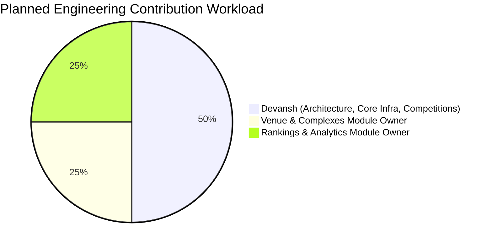

# CourtIQ — Project Overview

**Full Project Title:** CourtIQ – Tennis Data & Analytics Explorer  
**Tagline:** Explore Competitions. Analyse Rankings. Discover Tennis.  
**Repository:** `https://github.com/Devansh54/CourtIQ`  
**Remote URL:** `https://github.com/Devansh54/CourtIQ.git`  
**Repository Owner:** Devansh54  
**Repository Visibility:** Private  
**Technology Domain:** Sports Analytics / Data Analytics  
**Primary Technologies:** Python 3.12, Sportradar Tennis API (v3), Relational SQL, Streamlit, Plotly, Pydantic  

---

## 1. Executive Summary

CourtIQ is a professional, Sportradar-powered tennis data exploration and analytics platform designed to solve the challenge of transforming complex, deeply nested sports API responses into structured relational data, executing high-performance analytical queries, and delivering actionable sports intelligence through an interactive web dashboard.

Built using clean modular software engineering principles, CourtIQ provides sports analysts, tournament organizers, tennis enthusiasts, and sports governing bodies with real-time visibility into:
1. **Tennis Competitions & Hierarchies:** Comprehensive mapping of global tennis competition categories (ATP, WTA, ITF), parent-child competition hierarchies, gender classifications, and tournament formats.
2. **Sports Complexes & Venues:** Geographic and infrastructural distribution of world tennis complexes, venue capacities, city mappings, and timezones.
3. **Doubles Competitor Rankings:** Official doubles rankings, week-over-week rank movements, competitor profiles, point tallies, and country-level dominance metrics.

---

## 2. Business Use Cases

CourtIQ addresses four primary real-world business use cases specified in the project charter:

### 2.1 Event Exploration
Enable users to seamlessly navigate complex tennis competition hierarchies (e.g., ATP Vienna events, Grand Slams, qualifying vs. main draw sub-competitions) without getting lost in nested API structures.

### 2.2 Trend Analysis
Visualize the global distribution of tennis events by competition type (singles, doubles, mixed), gender category (men, women, mixed), and organizing body (ATP, WTA, ITF), identifying growth trends across regions.

### 2.3 Performance & Ranking Insights
Analyze doubles competitor performance, tracking point totals, weekly ranking volatility (movements), and tournament activity levels across diverse national federations.

### 2.4 Decision Support
Provide event organizers, facility managers, and tennis federations with quantitative data on venue geographic distribution, timezone scheduling implications, and regional competitor density to optimize tournament resource allocation.

---

## 3. Technology Stack & Rationale

| Layer | Technology | Version | Engineering Rationale |
|---|---|---|---|
| **Language** | Python | 3.12+ | Rich ecosystem for data engineering, typing, asynchronous I/O, and data science. |
| **API Integration** | Requests, Urllib3 | 2.31+ | Rock-solid HTTP transport, custom retry/backoff adapter, rate-limiting, and error handling. |
| **Data Validation** | Pydantic v2 | 2.5+ | High-performance schema validation, strict type enforcement, and parsing from nested JSON. |
| **Data Transformation** | Pandas | 2.0+ | Vectorized tabular transformations, missing value handling, and aggregation pipelines. |
| **Database** | SQLite / ANSI SQL | 3.x | Standard relational database engine included with Python standard library. Zero external installation overhead, ACID compliant, supports full foreign-key constraints and standard SQL. Designed for drop-in compatibility with PostgreSQL and MySQL. |
| **Visualization** | Plotly & Streamlit | 1.30+ | Highly responsive web interface, interactive filtering, cross-filtering charts, and real-time SQL execution. |
| **Testing** | Pytest, Pytest-Mock | 8.0+ | Robust test suite for unit, integration, and mock API pipeline verification. |

---

## 4. Scope Boundaries & Constraints

To maintain software quality and adhere to the project charter:
- **In Scope:**
  - Ingestion, relational modeling, SQL analytics, and visualization of **Competitions & Categories** from the Sportradar Competitions API.
  - Ingestion, relational modeling, SQL analytics, and visualization of **Complexes & Venues** from the Sportradar Complexes API.
  - Ingestion, relational modeling, SQL analytics, and visualization of **Doubles Competitor Rankings & Competitors** from the Sportradar Doubles Competitor Rankings API.
  - Complete 20 required analytical SQL queries across the three domains.
  - Interactive multi-page Streamlit application with KPI homepage dashboard.
  - Automated developer handoff documentation for sequential group contribution.
- **Out of Scope:**
  - Live point-by-point or match-by-match live match tracking (not specified in source guide).
  - Singles ATP/WTA rankings (the project guide specifically mandates the Doubles Competitor Rankings endpoint).
  - Commercial payment gateways, user authentication walls, or ticketing engines.

---

## 5. Team Contribution Structure

The project engineering workload is strictly distributed across three group contributors:

- **Devansh (50%):** Project Lead & Architect. Responsible for repository establishment, end-to-end software architecture, shared configuration, API client, database connection layer, logging, exceptions, database migration framework, common Streamlit shell and styling, and the complete Competitions & Categories business module (ingestion, persistence, all 7 SQL queries, analytics, Streamlit page, and tests).
- **Venue & Complexes Module Owner (25%):** Responsible for the Complexes & Venues business module (ingestion, persistence, all 7 SQL queries, analytics, Streamlit page, tests, and Rankings handoff document).
- **Rankings & Analytics Module Owner (25%):** Responsible for the Doubles Competitor Rankings business module (ingestion, persistence, all 6 SQL queries, analytics, Streamlit page, tests, regression validation, and final handover).

---

## 6. Project Deliverables

1. **Relational Database (`courtiq.db`):** 6 normalized tables with foreign-key relationships, indexed lookups, and migration scripts.
2. **API Ingestion Engine:** Modular extractors, transformers, and repositories with exponential backoff and rate-limit safety.
3. **Analytical Query Repository:** 20 verified SQL query files and execution helper methods.
4. **Interactive Streamlit Application:** Main KPI dashboard and 3 specialized analytical domain pages.
5. **Architectural & Developer Documentation:** Complete set of 11 repository documents and 2 developer handoff prompts.
