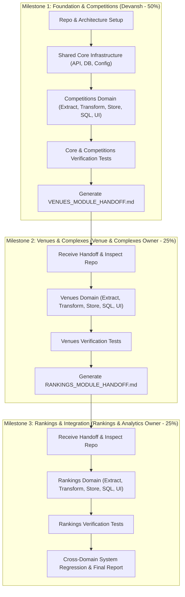

# CourtIQ — Team Workload & Contribution Allocation

**Project Name:** CourtIQ – Tennis Data & Analytics Explorer  
**Allocation Model:** 50% / 25% / 25% Planned Engineering Effort  
**Version:** 1.0.0  
**Effective Date:** 2026-11-04  

---

## 1. Workload Allocation Summary

The software engineering workload for the CourtIQ platform is distributed across three specialized contributors. Each contributor owns distinct domains, technical deliverables, and verification responsibilities while adhering to a shared architectural foundation.

| Contributor | Official Title & Ownership | Contribution | Planned Effort Units |
|---|---|:---:|:---:|
| **Devansh** | Project Architecture, Core Infrastructure & Competitions | **50%** | **50 Units** |
| **Venue & Complexes Module Owner** | Complexes, Venues & Related Analytics | **25%** | **25 Units** |
| **Rankings & Analytics Module Owner** | Doubles Competitor Rankings & Related Analytics | **25%** | **25 Units** |
| **Total Workload** | **Complete Software Product** | **100%** | **100 Units** |

> [!IMPORTANT]
> **Documentation Standards Rule:**  
> In accordance with project governance standards, generic labels such as "Person 1/2/3" or "Developer 1/2/3" are strictly prohibited across all documentation, commits, code comments, and handoff files. Only official professional titles defined above are permitted.

---

## 2. Devansh — Project Architecture, Core Infrastructure & Competitions (50%)

### 2.1 Scope & Responsibilities
Devansh carries primary architectural and foundational engineering responsibility. He establishes the overall project structure, configuration management, shared HTTP/API integration layer, relational database engine, migration framework, reusable logging and exception hierarchy, main application shell, and the complete Competitions & Categories business domain.

### 2.2 Effort Unit Breakdown (50 Units Total)

| Task ID | Activity Description | Planned Effort Units |
|---|---|:---:|
| `DEV-01` | **Repository Setup & Project Initialization:** Git repository setup, remote configuration, `.gitignore`, `.env.example`, directory structuring, preserving project guide. | 4 |
| `DEV-02` | **Requirement Analysis & Architecture Design:** Source PDF analysis, requirements traceability matrix, layered modular architecture design, complete 6-table ER diagram, interface specifications. | 8 |
| `DEV-03` | **Shared Core Infrastructure:** Centralized config (`config.py`), database layer (`database.py`), Sportradar API client with rate-limiting and retries (`api_client.py`), logging (`logging_config.py`), exception hierarchy (`exceptions.py`), migration runner, application shell (`app.py`), and design system (`formatting.py`). | 16 |
| `DEV-04` | **Competitions Ingestion Pipeline:** Competitions and categories schema definition (`schemas.py`), API extractor (`extractor.py`), JSON-to-relational transformer (`transformer.py`), idempotent SQL repository (`repository.py`), and migration script (`001_competitions.sql`). | 10 |
| `DEV-05` | **Competitions Analytics & UI:** Implementation of all 7 required SQL queries (`sql/queries/competitions/`), analytics service (`analytics.py`), and interactive Streamlit page (`pages/1_Competitions.py`). | 6 |
| `DEV-06` | **Testing, Documentation & First Handoff:** Comprehensive unit and integration test suite for core and competitions, complete project documentation suite, and copy-paste-ready developer handoff prompt (`docs/handoffs/VENUES_MODULE_HANDOFF.md`). | 6 |
| **Total** | **Devansh's Planned Engineering Contribution** | **50** |

### 2.3 Key Deliverables
- Clean Git repository connected to `https://github.com/Devansh54/CourtIQ.git`.
- `src/courtiq/core/` shared infrastructure package.
- `src/courtiq/domains/competitions/` fully functioning domain module.
- `sql/migrations/001_competitions.sql` and migration runner.
- All 7 Competitions SQL queries implemented in SQL and repository methods.
- `app.py` Homepage Dashboard and `pages/1_Competitions.py`.
- Complete test suite in `tests/unit/` and `tests/integration/`.
- Developer handoff prompt: `docs/handoffs/VENUES_MODULE_HANDOFF.md`.

---

## 3. Venue & Complexes Module Owner — Complexes, Venues & Related Analytics (25%)

### 3.1 Scope & Responsibilities
The Venue & Complexes Module Owner is responsible for the end-to-end implementation of the Complexes and Venues domain. This contributor reuses Devansh's core infrastructure (API client, database connection, config, logging) to extract, transform, persist, analyze, and visualize complex and venue data.

### 3.2 Effort Unit Breakdown (25 Units Total)

| Task ID | Activity Description | Planned Effort Units |
|---|---|:---:|
| `VEN-01` | **API Extraction & Transformation:** Complexes extractor (`extractor.py`), Pydantic schemas (`schemas.py`), JSON-to-relational transformer for complexes and venues (`transformer.py`). | 6 |
| `VEN-02` | **Database Implementation & SQL Analytics:** Migration script (`002_venues.sql`), SQL repository (`repository.py`), and implementation of all 7 required SQL queries (`sql/queries/venues/`). | 7 |
| `VEN-03` | **Venues Streamlit UI:** Implementation of `pages/2_Venues.py` with country filters, timezone breakdowns, multi-venue complex analyzer, and charts. | 6 |
| `VEN-04` | **Testing, Documentation & Subsequent Handoff:** Venues unit and integration tests, updating documentation, and generating copy-paste-ready prompt (`docs/handoffs/RANKINGS_MODULE_HANDOFF.md`). | 6 |
| **Total** | **Venue & Complexes Module Owner Planned Effort** | **25** |

### 3.3 Key Deliverables
- `src/courtiq/domains/venues/` business module.
- `sql/migrations/002_venues.sql`.
- All 7 Venues SQL queries in `sql/queries/venues/`.
- `pages/2_Venues.py` interactive Streamlit page.
- Unit and integration tests in `tests/unit/venues/`.
- Subsequent developer handoff: `docs/handoffs/RANKINGS_MODULE_HANDOFF.md`.

---

## 4. Rankings & Analytics Module Owner — Doubles Competitor Rankings & Related Analytics (25%)

### 4.1 Scope & Responsibilities
The Rankings & Analytics Module Owner is responsible for the complete doubles competitor rankings domain, competitor profiles, point tallies, ranking movements, and leading the final end-to-end integration verification across all three modules.

### 4.2 Effort Unit Breakdown (25 Units Total)

| Task ID | Activity Description | Planned Effort Units |
|---|---|:---:|
| `RNK-01` | **API Extraction & Transformation:** Rankings extractor (`extractor.py`), Pydantic schemas (`schemas.py`), JSON-to-relational transformer for competitors and rankings (`transformer.py`). | 6 |
| `RNK-02` | **Database Implementation & SQL Analytics:** Migration script (`003_rankings.sql`), SQL repository (`repository.py`), and implementation of all 6 required SQL queries (`sql/queries/rankings/`). | 7 |
| `RNK-03` | **Rankings Streamlit UI:** Implementation of `pages/3_Rankings.py` with competitor search, leaderboards, country distributions, and detail modals. | 6 |
| `RNK-04` | **Testing, Regression & Final Handover:** Rankings unit tests, system-wide cross-domain regression testing, updating final documentation, and final deliverable sign-off. | 6 |
| **Total** | **Rankings & Analytics Module Owner Planned Effort** | **25** |

### 4.3 Key Deliverables
- `src/courtiq/domains/rankings/` business module.
- `sql/migrations/003_rankings.sql`.
- All 6 Rankings SQL queries in `sql/queries/rankings/`.
- `pages/3_Rankings.py` interactive Streamlit page.
- Unit and regression tests in `tests/unit/rankings/`.
- Final system-wide validation and technical completion sign-off.

---

## 5. Sequential Engineering & Dependency Workflow

The project follows a disciplined sequential relay model. No contributor works in a vacuum; each phase builds cleanly on the preceding milestone:

---

## 6. Integration & Governance Rules

1. **Shared Interface Immutability:** The shared core infrastructure in `src/courtiq/core/` is authored and maintained by Devansh. Module owners must use these interfaces rather than writing private API clients or separate database connection managers.
2. **Domain Encapsulation:** Code belonging to a specific domain (`competitions/`, `venues/`, `rankings/`) must remain strictly within its respective domain directory.
3. **Migration Numbering:** Migrations must follow the sequential three-digit prefix: `001_competitions.sql`, `002_venues.sql`, `003_rankings.sql`.
4. **Git Branching:** Contributors work on their designated branches (`devansh-foundation-competitions`, `feature/venues-complexes`, `feature/competitor-rankings`) and integrate via Pull Requests.
